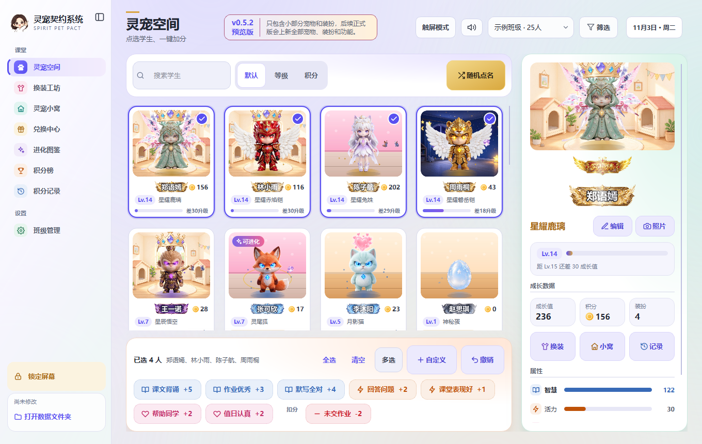
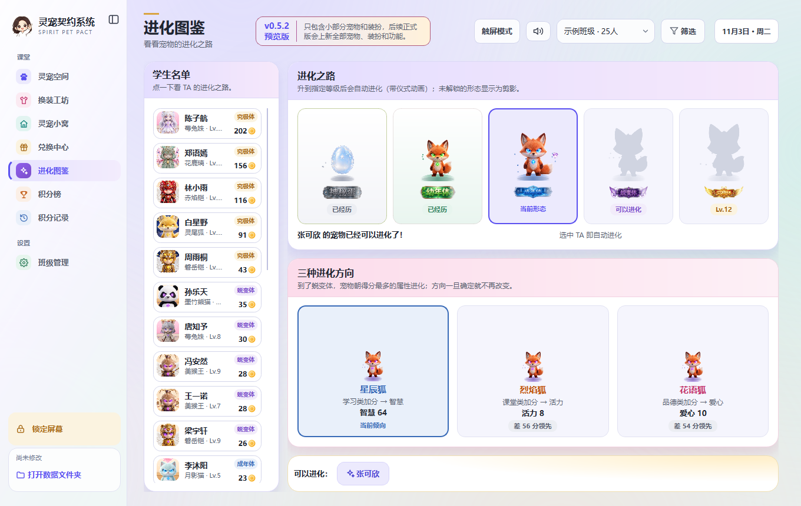
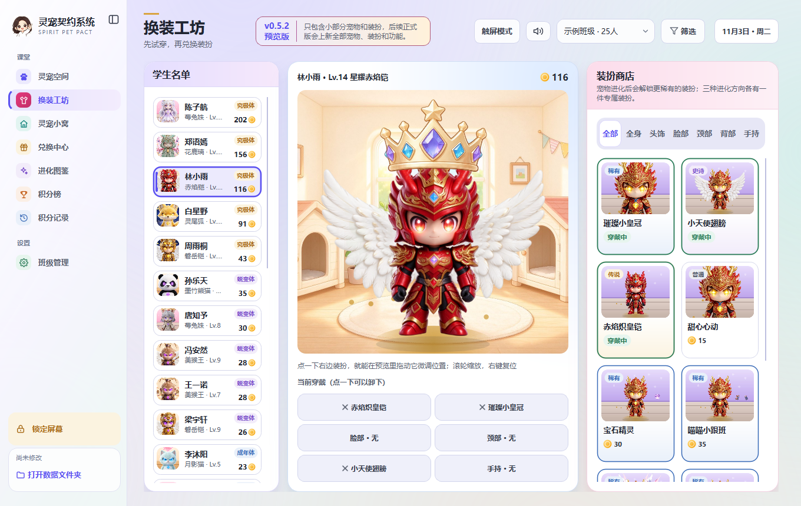
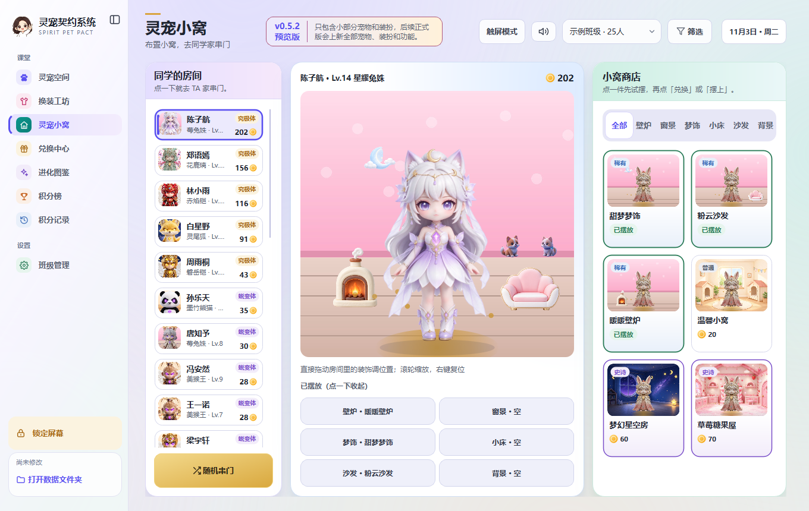
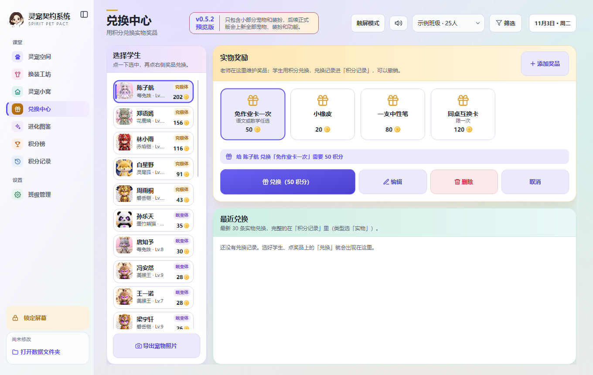
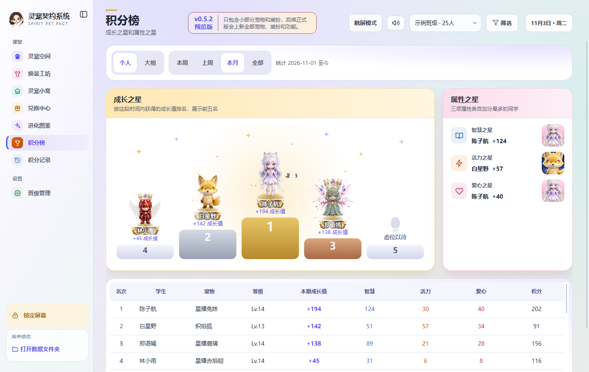
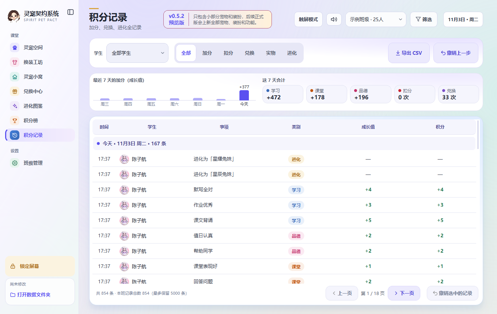

<h1 align="center">灵宠契约系统 · 预览版</h1>

<b>把课堂上的每一次好表现，养成一只会进化的小灵宠。</b>

每位同学领养一只灵宠：背课文、答问题、帮同学，灵宠就会长大、进化、换上新装； 
攒下的积分还能布置自己的小窝，或者向老师兑换真实的小奖品。

  
  
  
  

> 这里是**预览版**的下载页：只包含小部分灵宠和装扮，后续正式版会上新全部灵宠、装扮和功能。
> 本仓库只放说明和下载包，不包含源代码。下面的截图都来自预览版。

## 下载

到右侧的 **Releases**（发行版）下载 `ClassPetPark-v0.5.2-preview-win64.zip`，解压后双击
`重生之我在班里养灵宠_v0.5.2预览版.exe` 就能用，不需要安装，也可以直接放在 U 盘上运行。

- GitHub：<https://github.com/zhangzht-lab/lingchong-preview/releases>
- Gitee（国内更快）：<https://gitee.com/zhang-bantao/lingchong-preview/releases>

压缩包里带了一个 25 人的「示例班级」（学生名字都是虚构的），打开就能体验；正式用时在
「班级管理 → 学生管理」新建自己的班级，示例班级可以删掉。

## 预览版包含什么

- **灵宠 9 种**：萌宠 4 种（月影猫、雪绒兔、墨竹熊猫、灵尾狐）、铠甲 2 种（赤焰铠、磐岳铠）、仙子 2 种（莓兔姝、花鹿璃）、美猴王。
- **装扮、背景和小窝装饰 16 件**：头饰、手持、背部、全身装扮、背景和小窝家具各几件。
- **完整的课堂功能**：
  - **灵宠空间**：全班卡片，点选学生一键加分 / 扣分，随机点名，撤销。
  - **成长和进化**：成长值决定等级，到级自动进化（带动画）；按学习 / 课堂 / 品德三类加分，蜕变体分成三种进化方向。
  - **换装工坊、灵宠小窝**：用积分换装扮、布置小窝，去同学家串门。
  - **兑换中心**：老师自己添加实物奖品，学生用积分兑换。
  - **积分榜、积分记录**：个人榜和大组榜，每一条加分都能查、能撤销、能导出。
  - **班级管理**：名单、小组、积分规则、等级体系、数据备份和学期归档。

## 看看预览版

**进化**：升到指定等级，灵宠会自动进化，全班一起看进化仪式。

 

**换装工坊**：先试穿，再用积分兑换；铠甲、翅膀、皇冠都能穿在身上。

**灵宠小窝**：摆壁炉、沙发、梦饰，还能去同学家串门。

**兑换中心和积分榜**：积分换实物奖品；领奖台上站着本月的成长之星。

 

## 运行环境

- Windows 10 / 11（64 位）。不支持 Windows 7，也不能在希沃白板的安卓主页上运行。
- 程序没有数字签名，第一次运行如果出现「Windows 已保护你的电脑」，点「更多信息」→「仍要运行」。
- 希沃白板上点右上角「触屏模式」，按钮会放大，手指更容易点中。

## 数据

所有数据都存在 exe 旁边的 `ClassPetData` 文件夹里（加分后立刻保存，每次打开自动备份）。
换电脑时把 exe 和这个文件夹一起拷走；正式版出来后，用新的 exe 替换这个 exe 即可，数据会自动沿用。
程序不联网、不上传，学生名字和积分只在这台电脑或这个 U 盘里。

## 版权

版权所有 © 2026 Kula，保留所有权利。本软件不开源，可以免费下载、用于教学；
未经许可不得复制、修改、反编译、再分发或商用。压缩包里附有完整的许可声明（LICENSE.txt）
和第三方组件许可（THIRD_PARTY_NOTICES.txt，Qt / PySide6 等）。

宠物形象和装扮由 AI 生成；示例班级里的学生名字都是虚构的。
